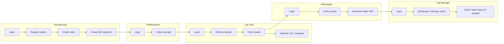
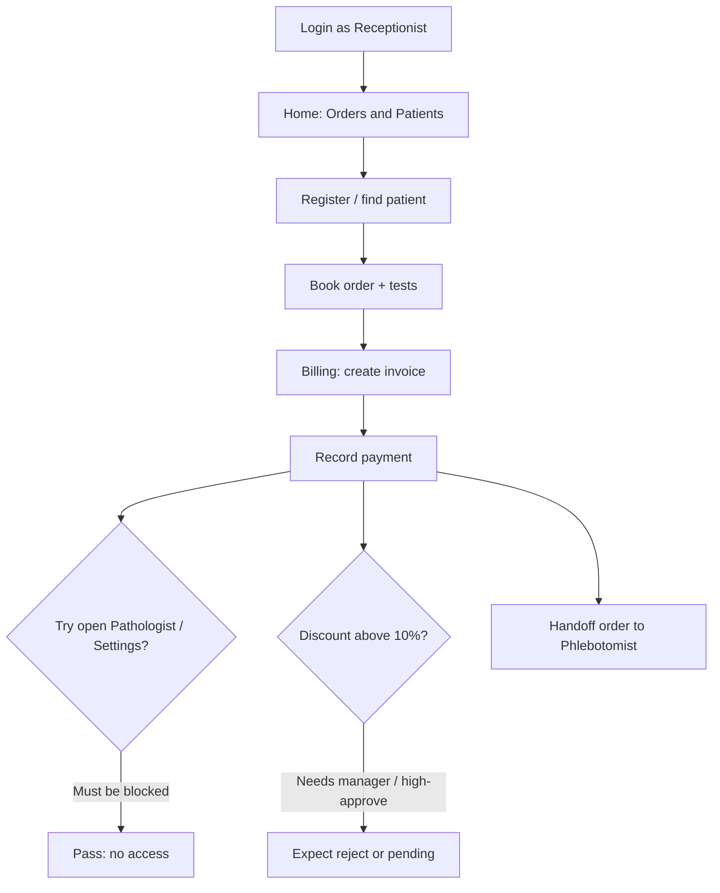
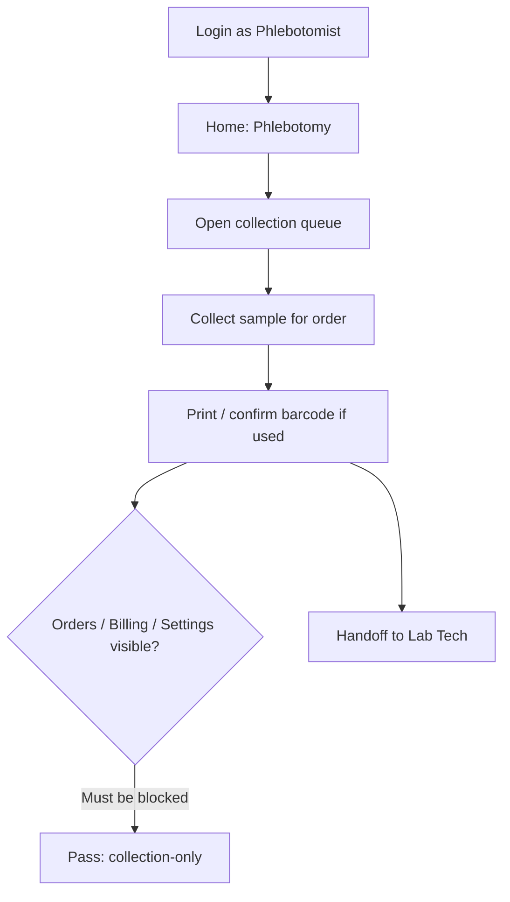
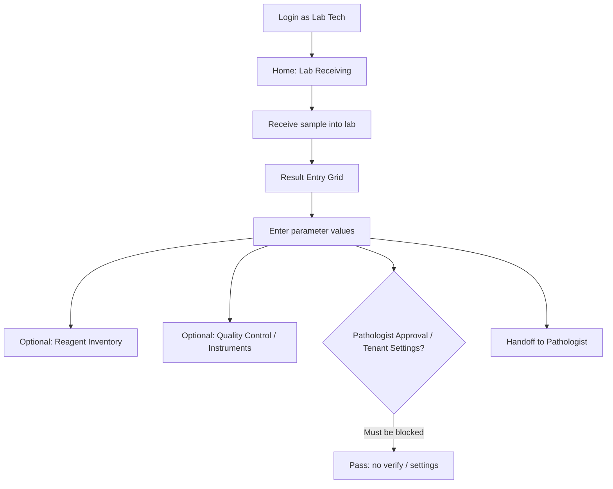
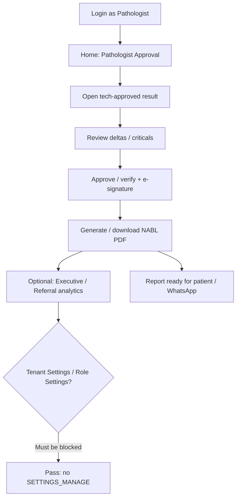
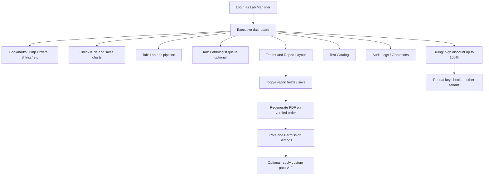
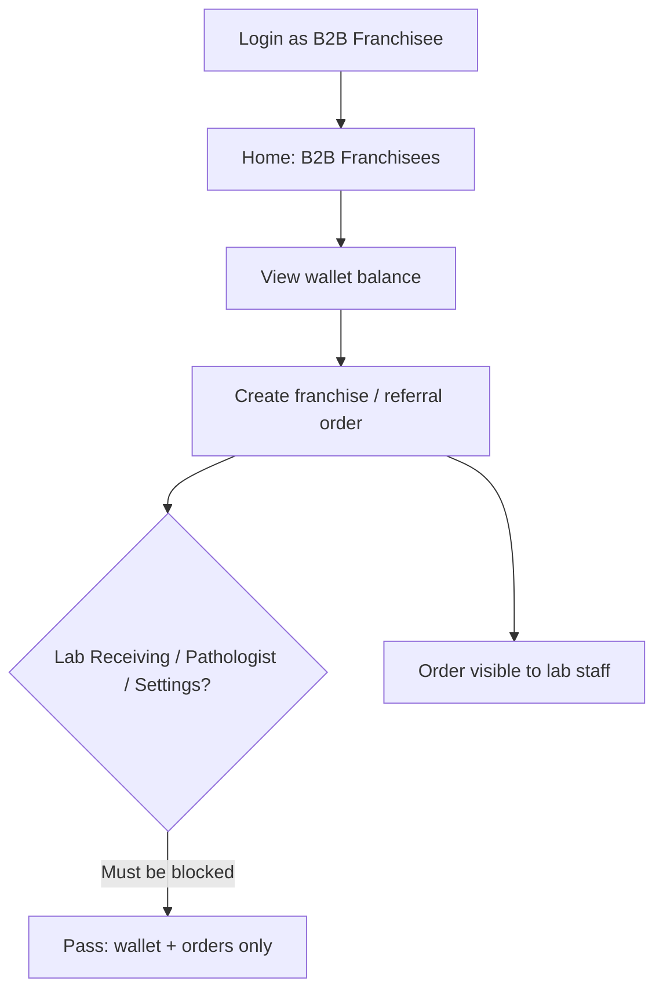
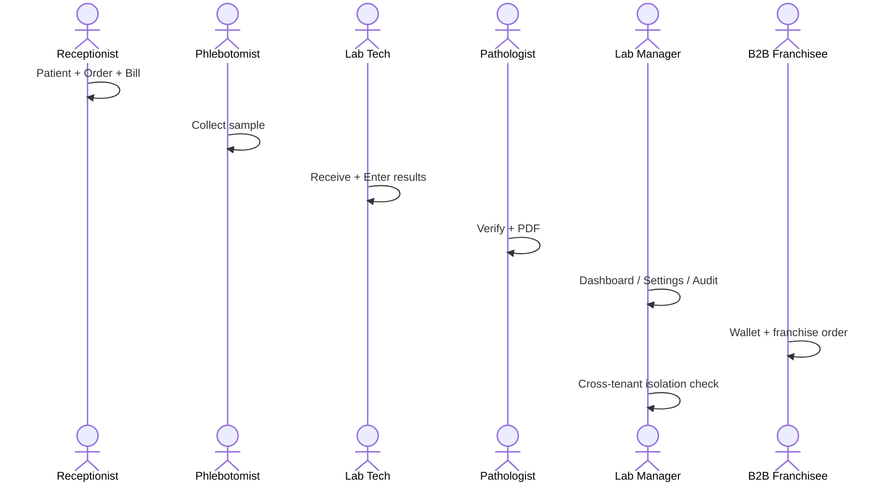
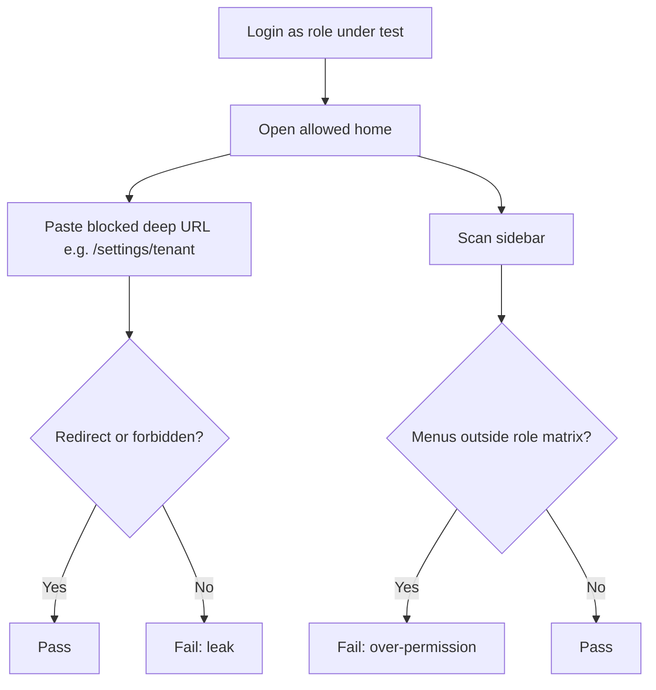

# DiagLab — Cumulative Role & Access Testing Guide

Use this file to **pick logins and build custom permission sets** so every screen and workflow can be tested.

Credentials: `creds.txt`  
Permission source: `backend/src/modules/auth/permissions.ts`

---

## 1. Seeded accounts (copy-paste ready)

### Demo Lab — org: `demo` — password: `DemoPass123!`

| # | Who to login as | Email | Role code | Use to test |
|---|-----------------|-------|-----------|-------------|
| D1 | Full lab power user | `admin@demo.local` | `LAB_MANAGER` | Everything in one tenant except SaaS Admin |
| D2 | Front desk / cashier | `receptionist@demo.local` | `RECEPTIONIST` | Patients, orders, billing |
| D3 | Sample collector | `phlebo@demo.local` | `PHLEBOTOMIST` | Phlebotomy only |
| D4 | Bench tech | `labtech@demo.local` | `LAB_TECH` | Receiving, results, reagents, QC, instruments |
| D5 | Doctor / verifier | `pathologist@demo.local` | `PATHOLOGIST` | Verify, PDF/WhatsApp, analytics, result entry |
| D6 | Franchise partner | `b2b@demo.local` | `B2B_FRANCHISEE` | B2B wallet + order create |

### Apollo Lab — org: `apollo` — password: `password123`

| # | Who to login as | Email | Role code | Use to test |
|---|-----------------|-------|-----------|-------------|
| A1 | Lab Manager | `manager@apollo.com` | `LAB_MANAGER` | Same as D1 on Apollo (report layout, branding, multi-tenant isolation) |
| A2 | Receptionist | `cashier@apollo.com` | `RECEPTIONIST` | Same as D2 |
| A3 | Phlebotomist | `phleb@apollo.com` | `PHLEBOTOMIST` | Same as D3 |
| A4 | Lab Tech | `tech@apollo.com` | `LAB_TECH` | Same as D4 |
| A5 | Pathologist | `doctor@apollo.com` | `PATHOLOGIST` | Same as D5 |
| A6 | Franchisee | `center1@franchisee.com` | `B2B_FRANCHISEE` | Same as D6 |

**Tenant isolation check:** do the same action on Demo (D1) vs Apollo (A1) — configs and data must not leak across labs.

---

## 2. Cumulative feature × role matrix

`Y` = default access · blank = no access · `*` = Lab Manager can grant via custom permissions

| Feature / screen | Route | Permission needed | Lab Manager | Receptionist | Phlebotomist | Lab Tech | Pathologist | B2B |
|------------------|-------|-------------------|:-----------:|:------------:|:------------:|:--------:|:-----------:|:---:|
| Executive Dashboard | `/` | `ANALYTICS_VIEW` | Y | | | | Y | |
| Orders & Patients | `/orders`, `/patients` | `PATIENT_MANAGE` **or** `ORDER_CREATE` | Y | Y | | | | Y |
| Phlebotomy & Logistics | `/phlebotomy` | `SAMPLE_COLLECT` | Y | | Y | | | |
| Lab Receiving | `/lab-receiving` | `SAMPLE_RECEIVE` | Y | | | Y | | |
| Result Entry Grid | `/lab-results` | `RESULT_ENTRY` | Y | | | Y | Y | |
| Pathologist Approval | `/pathologist` | `PATHOLOGIST_VERIFY` | Y | | | | Y | |
| PDF Reports & WhatsApp | `/pathologist`, `/reports` | `PATHOLOGIST_VERIFY` | Y | | | | Y | |
| Billing & invoices | `/billing`, `/payments` | `BILLING_CREATE` | Y | Y | | | | |
| B2B Franchisees / wallet | `/b2b` | `B2B_WALLET_MANAGE` | Y | | | | | Y |
| Referral Analytics | `/analytics/referrals` | `ANALYTICS_VIEW` | Y | | | | Y | |
| Machine Interfacing | `/instruments` | `QC_MANAGE` | Y | | | Y | | |
| Reagent Inventory | `/inventory-qc?tab=inventory` | `REAGENT_MANAGE` | Y | | | Y | | |
| Quality Control | `/inventory-qc?tab=qc` | `QC_MANAGE` | Y | | | Y | | |
| Test Catalog / Test Studio | `/settings/catalog` | `SETTINGS_MANAGE` | Y | | | | | |
| Role & Permission Settings | `/settings/permissions` | `SETTINGS_MANAGE` | Y | | | | | |
| Tenant & Report Layout | `/settings/tenant` | `SETTINGS_MANAGE` | Y | | | | | |
| Operations Console | `/operations` | `SETTINGS_MANAGE` | Y | | | | | |
| Audit Logs | `/audit-logs` | `SETTINGS_MANAGE` | Y | | | | | |
| SaaS Admin | `/saas-admin` | Super Admin only | | | | | | |
| High discount approval | (billing action) | `DISCOUNT_APPROVE_HIGH` | Y | * | * | * | * | * |
| Max discount % | — | role rule | 100% | 10% | 10% | 10% | 25% | 10% |

Blank cells marked `*` can be opened for a user by Lab Manager under **Role & Permission Settings** (custom permission list).

---

## 3. Minimal login set to cover ALL default features

You do **not** need every account every day. This set covers the whole product with defaults:

| Step | Login | Covers |
|------|-------|--------|
| 1 | `admin@demo.local` **or** `manager@apollo.com` | All menus + settings + report layout + high discounts |
| 2 | `receptionist@demo.local` **or** `cashier@apollo.com` | Front-desk only surface (deny clinical/settings) |
| 3 | `phlebo@demo.local` **or** `phleb@apollo.com` | Collection-only surface |
| 4 | `labtech@demo.local` **or** `tech@apollo.com` | Receiving + results + inventory/QC |
| 5 | `pathologist@demo.local` **or** `doctor@apollo.com` | Verify + PDF + analytics |
| 6 | `b2b@demo.local` **or** `center1@franchisee.com` | Franchise wallet + order |
| 7 | Switch Demo ↔ Apollo with Lab Manager | Multi-tenant isolation |

That is **6 role personas + 1 tenant switch** = full default coverage.

---

## 4. Custom access packs you can CREATE for deeper testing

Login as Lab Manager → **Role & Permission Settings** → assign custom permissions on a non-manager user  
(e.g. Receptionist, Lab Tech, Phlebotomist).  
When `customPermissions` is set, **defaults are replaced** by that list (except Lab Manager / Super Admin, who always stay full-access).

### Pack A — “Front desk + light clinical”
**Base user:** Receptionist  
**Custom permissions:**
```
PATIENT_MANAGE, ORDER_CREATE, BILLING_CREATE, SAMPLE_COLLECT
```
**Tests:** cashier can also open Phlebotomy; still blocked from results/verify/settings.

### Pack B — “Tech who can bill”
**Base user:** Lab Tech  
**Custom permissions:**
```
SAMPLE_RECEIVE, RESULT_ENTRY, REAGENT_MANAGE, QC_MANAGE, BILLING_CREATE
```
**Tests:** bench tech + billing; no pathologist verify, no settings.

### Pack C — “Verifier-only (strict)”
**Base user:** Pathologist  
**Custom permissions:**
```
PATHOLOGIST_VERIFY
```
**Tests:** only approval/PDF menus; no result entry, no dashboard analytics.

### Pack D — “Analytics + settings power user (not manager role)”
**Base user:** any non-manager (e.g. Lab Tech)  
**Custom permissions:**
```
ANALYTICS_VIEW, SETTINGS_MANAGE, ORDER_CREATE
```
**Tests:** dashboard + tenant/report layout + catalog without full clinical suite.  
Confirm Lab Manager-only APIs still reject where role is checked explicitly (e.g. some tenant update paths also accept LAB_MANAGER).

### Pack E — “High discount cashier”
**Base user:** Receptionist  
**Custom permissions:**
```
PATIENT_MANAGE, ORDER_CREATE, BILLING_CREATE, DISCOUNT_APPROVE_HIGH
```
**Tests:** billing discounts up to 25% (high-approve path) vs default 10% without this flag.  
Lab Manager still needed for 100%.

### Pack F — “Full clinical chain on one user”
**Base user:** Lab Tech (or Receptionist)  
**Custom permissions:**
```
PATIENT_MANAGE, ORDER_CREATE, SAMPLE_COLLECT, SAMPLE_RECEIVE,
RESULT_ENTRY, PATHOLOGIST_VERIFY, BILLING_CREATE
```
**Tests:** one account walks patient → collect → receive → enter → verify → bill (no inventory/settings).

### Pack G — “Franchisee expanded”
**Base user:** B2B Franchisee  
**Custom permissions:**
```
B2B_WALLET_MANAGE, ORDER_CREATE, PATIENT_MANAGE, BILLING_CREATE
```
**Tests:** franchise partner can register patients and bill; still no lab bench / settings.

### Pack H — “Deny everything (negative test)”
**Base user:** any non-manager  
**Custom permissions:**
```
(empty list is treated as “use defaults” in code — so set a single harmless unused combo carefully)
```
**Practical negative test:** leave custom empty (defaults apply), **or** set only one narrow permission and confirm other routes redirect/403.  
Example narrow:
```
SAMPLE_COLLECT
```
on a Receptionist → only Phlebotomy remains.

### Pack I — “Inventory-only auditor”
**Base user:** Phlebotomist  
**Custom permissions:**
```
REAGENT_MANAGE, QC_MANAGE, ANALYTICS_VIEW
```
**Tests:** inventory/QC/dashboard without sample collect (overrides phlebotomy default).

---

## 5. End-to-end test checklist (cumulative)

Walk this once per tenant (Demo and/or Apollo). Check boxes as you go.

### A. Receptionist journey
- [ ] Login receptionist → lands on `/orders`
- [ ] Create/register patient
- [ ] Create order
- [ ] Create bill / take payment
- [ ] Confirm Phlebotomy / Lab Results / Settings **not** in sidebar
- [ ] Discount ≤ 10% succeeds; higher may need manager / high-approve

### B. Phlebotomist journey
- [ ] Login phleb → `/phlebotomy`
- [ ] Collect sample for receptionist’s order
- [ ] Confirm no billing / settings

### C. Lab Tech journey
- [ ] Login tech → `/lab-receiving`
- [ ] Receive sample
- [ ] Enter results on Result Entry Grid
- [ ] Open Reagent Inventory + QC + Instruments
- [ ] Confirm no Pathologist Approval / Settings

### D. Pathologist journey
- [ ] Login doctor → `/pathologist`
- [ ] Verify results
- [ ] Generate / download NABL PDF
- [ ] Open dashboard / referral analytics
- [ ] Confirm no Tenant Settings

### E. Lab Manager journey
- [ ] Login manager/admin → `/`
- [ ] Open **Tenant & Report Layout** — change a patient field / footer QR toggle → save
- [ ] Regenerate PDF — layout change appears
- [ ] Open Role & Permission Settings — apply Pack A or F on a user → re-login that user → verify menus
- [ ] Apply 50–100% discount on a bill
- [ ] Open Audit Logs + Operations Console + Test Catalog

### F. B2B journey
- [ ] Login franchisee → `/b2b`
- [ ] View wallet / place franchise order
- [ ] Confirm no lab receiving / pathologist / settings

### G. Cross-tenant
- [ ] Same flow on Demo then Apollo with Lab Manager
- [ ] Report layout / branding on Apollo does not change Demo

### H. Custom packs (optional deep)
- [ ] Pack A — receptionist sees Phlebotomy
- [ ] Pack C — pathologist loses Result Entry + Dashboard
- [ ] Pack E — high discount on cashier
- [ ] Pack F — single-user full clinical chain
- [ ] Pack H/narrow — denied screens stay denied

---

## 6. Permission → “who has it by default” (reverse index)

| Permission | Default roles that have it |
|------------|----------------------------|
| `PATIENT_MANAGE` | Lab Manager, Receptionist |
| `ORDER_CREATE` | Lab Manager, Receptionist, B2B Franchisee |
| `SAMPLE_COLLECT` | Lab Manager, Phlebotomist |
| `SAMPLE_RECEIVE` | Lab Manager, Lab Tech |
| `RESULT_ENTRY` | Lab Manager, Lab Tech, Pathologist |
| `PATHOLOGIST_VERIFY` | Lab Manager, Pathologist |
| `BILLING_CREATE` | Lab Manager, Receptionist |
| `DISCOUNT_APPROVE_HIGH` | Lab Manager only (by default) |
| `B2B_WALLET_MANAGE` | Lab Manager, B2B Franchisee |
| `REAGENT_MANAGE` | Lab Manager, Lab Tech |
| `QC_MANAGE` | Lab Manager, Lab Tech |
| `ANALYTICS_VIEW` | Lab Manager, Pathologist |
| `SETTINGS_MANAGE` | Lab Manager only (by default) |

To test a permission that only Lab Manager has (`SETTINGS_MANAGE`, `DISCOUNT_APPROVE_HIGH`), either:
1. Use Lab Manager login, or  
2. Grant that permission via a **custom pack** on another role.

---

## 7. Recommended daily smoke (15 minutes)

| Order | Account | 2–3 actions |
|-------|---------|-------------|
| 1 | `cashier@apollo.com` | New patient + order + bill |
| 2 | `phleb@apollo.com` | Collect |
| 3 | `tech@apollo.com` | Receive + enter result |
| 4 | `doctor@apollo.com` | Verify + PDF |
| 5 | `manager@apollo.com` | Peek settings / report layout |
| 6 | `center1@franchisee.com` | Open B2B wallet |

Swap `apollo` ↔ `demo` emails when testing Demo org.

---

## 8. Notes / gotchas for testers

1. **Demo Admin = Lab Manager**, not SaaS Super Admin. `/saas-admin` stays hidden.
2. Custom permissions **replace** role defaults (they do not merge), except Lab Manager/Super Admin who always get everything.
3. Sidebar and routes both gate on permissions — if a menu is missing, the deep URL should also block.
4. PDF/report layout changes need **Lab Manager** (`SETTINGS_MANAGE`) and a **new PDF generate** to see effect.
5. Passwords: Demo `DemoPass123!` · Apollo `password123`.
6. Re-seed accounts: `npm run seed` (with seeding enabled in backend `.env`).

---

## 9. End-to-end test flowcharts (every role)

Use these as the **order of steps** when testing. Swimlane = who logs in.  
Accounts: Demo `*@demo.local` / Apollo emails in §1 · passwords in `creds.txt`.

### 9.1 Master clinical happy path (all roles, one order)



### 9.2 Receptionist / Cashier

**Login:** `receptionist@demo.local` or `cashier@apollo.com` → lands `/orders`



### 9.3 Phlebotomist

**Login:** `phlebo@demo.local` or `phleb@apollo.com` → lands `/phlebotomy`



### 9.4 Lab Technician

**Login:** `labtech@demo.local` or `tech@apollo.com` → lands `/lab-receiving`



### 9.5 Pathologist

**Login:** `pathologist@demo.local` or `doctor@apollo.com` → lands `/pathologist`



### 9.6 Lab Manager / Demo Admin

**Login:** `admin@demo.local` or `manager@apollo.com` → lands `/` **Executive** (bookmarks + charts)



### 9.7 B2B Franchisee

**Login:** `b2b@demo.local` or `center1@franchisee.com` → lands `/b2b`



### 9.8 Full E2E day (role sequence)



### 9.9 Negative-access flowchart (every non-manager role)


